# proyecto-final-algoritmos-2790-26-12588
Proyecto final
 ## Uso de IA
IA utilizada : Gemini y Claude 

## Hito 1 

¿Que le pregunte?:

Le dije que revisara mi pseudocodigo para correciones de ser necesarias
Le pregunte que tipo de dato usar para validar la opción del menú.
Le dije que me ayudara diciendome otra forma de hacer un ciclo con validacion porque no sabia si había otra forma de hacerlo
Por ultimo para el hito 1 le pedi que revisara mi codigo y me corrigiera si era necesario.

¿Que acepte?:

Acepte el cambio que me sugiria de separar los casos del precio y la validacion del mismo porque la logica que tenia no era edl todo acertada
Me surgirio para el pseudocodigo colocarle sangria para que se leyera de mejor forma
Acepte la opcion en el pseudocodigo de usar el "De otro modo" no lo recordaba bien pero era lo que necesitaba para poder realizar bien la logica que deseaba
Tenia una error en el codigo asi que me sugirio mover el menu dentro del ciclo, asi como corregir parte de los operadores de las condiciones
Tambien me sugirio arreglar el subtotal y reiniciarlo en cada venta 

¿Que rechace?:

Me habia segerido que incluyera en el analisis los rangos exactos de las validaciones y la lista concreta de acumuladores, pero lo rechace porque los mismos ya estan en el pseudocodigo 

## Hito 2

¿Que le pregunte?: 

Empece enseñandole mi borrador para iniciar el bloque de descuentos preguntandole si habia algun error en el 
Le envie mi pseudocodigo de nuevo y pregunté si los bloques de IVA, pago y del resumen estaban bien y le pedí que me guiara un poco para hacer el resumen del día.
Por ultimo le pedí casos de prueba asi comoo tambien sobre algunas dudas como que diferencia hay entre float y double, y cómo hacer commit de un solo archivo porque aun no tenia todos listos para subir a GitHub.

¿Que acepte?:

En el bloque de descuentos me dio algunas correcciones como cambiar el "o" que tenia yo por un "y" al momento de hacer una validacion doble, asi como tambien me menciono que no estaba cubriendo del todo las cantidades al momento de validar si el descuento aplicaba o no. 
Acepte algunos errores que me menciono de errores de escritura como falta de comas, comillas incorrectas y sangrias en el pseudocodigo.
Tambien me sugirio cambiar mis variables float por double porque uno de los calculos me quedaba con muchos decimales y para que quedase mas limpio en el mostrar me dijo que de preferencia usara double.

¿Que rechace?:

El unico cambio que rechace fue minimo y era un mensaje que se mostraba al no validar una condicion y era para las ventas, me insistia que colocara que no se habian registrado productos pero se me hizo mas practico dejarlo en que no se habian registrado ventas.

## Hito 3 

Casos de prueba brindados por el documento:

Caso 1: Venta de 99.99 (sin descuento) 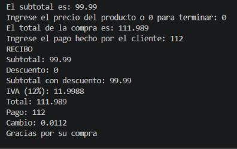
        Venta de 100 (limite del 5%) 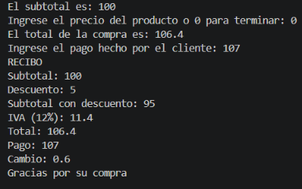
Caso 2: Venta de 500 (limite del 10%) 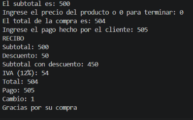
Caso 3: Cantidad 0, 101, precio negativo y opcion de menu 9 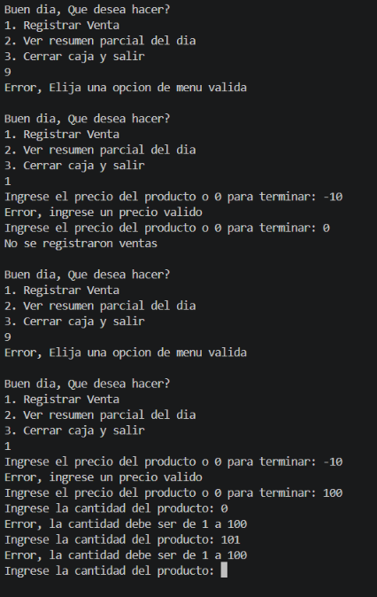 
Caso 4: Resumen del dia sin ventas 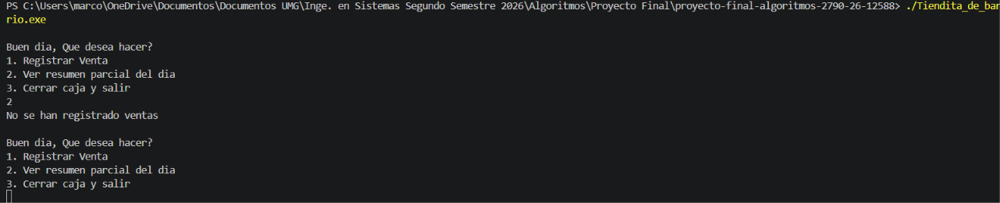
Caso 5: Pago menor al total  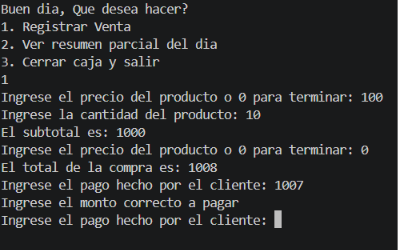

## Casos de prueba sugeridos por la IA:

Prueba 1: resumen sin ventas

Qué probé: elegir la opción 2 antes de registrar cualquier venta.
Esperado: el mensaje “No se han registrado ventas”, sin dividir entre cero.
Obtenido: correcto.
Qué probé después: elegir la opción 1 y poner 0 como primer precio.
Esperado: “No se registraron ventas” y sin pedir pago.
Obtenido: correcto. Al volver a la opción 2, sigue sin contar ventas.

Imagen de demostracion: 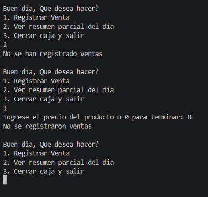

Prueba 2: serie de ventas y resumen del día

Venta A: 
-Producto: de Q50, cantidad 2, pago de Q110. 
-Esperado: descuento Q5, IVA Q11.40, total Q106.40, cambio Q3.60. 
-Resumen esperado: 1 venta, total vendido 106.4, mayor y menor 106.4, descuentos 5.

Imagen de demostracion: 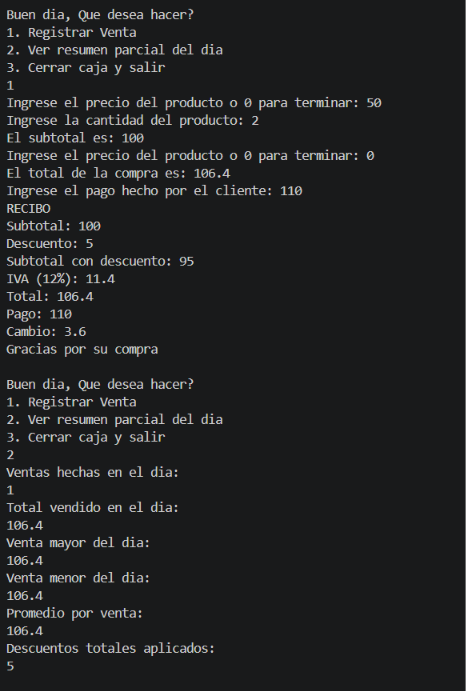

Venta B: 
-Producto de Q20, cantidad 1, pago de Q25. 
-Esperado: sin descuento, IVA Q2.40, total Q22.40, cambio Q2.60. 
-Resumen esperado: 2 ventas, total 128.8, mayor 106.4, menor 22.4, promedio 64.4.

Imagen de demostracion: 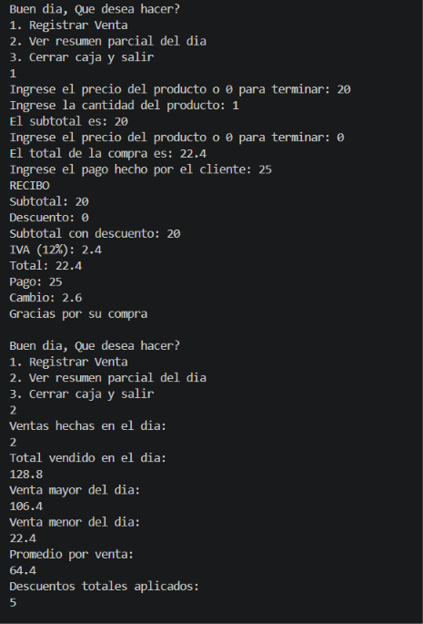

Venta C: 
-Producto de Q100, cantidad 6, primero pago de Q600 y luego de Q610. 
-Esperado: descuento Q60, IVA Q64.80, total Q604.80. Con Q600 el programa vuelve a pedir el pago, y con Q610 el cambio es Q5.20. 
-Resumen esperado: 3 ventas, total 733.6, mayor 604.8, menor 22.4, promedio 244.533, descuentos 65.

Imagen de demostracion: 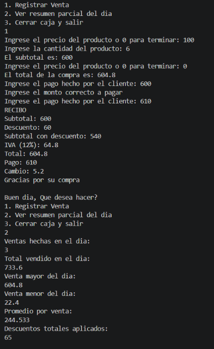

Prueba 3: límites del descuento

Con una venta de un solo producto de cantidad 1: precio Q99 da total Q110.88 (sin descuento), precio Q100 da Q106.40 (5 %) y precio Q500 da Q504 (10 %). 

Imagen de demostracion (sin descuento): 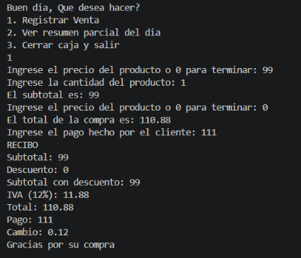 
Imagenes de demostracion (5%): 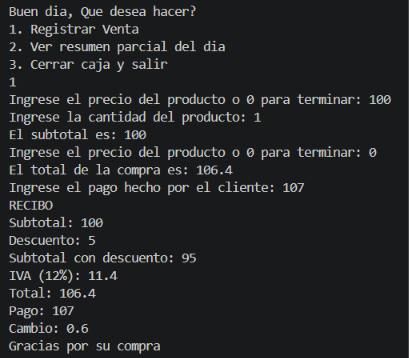
Imagenes de demostracion (10%): 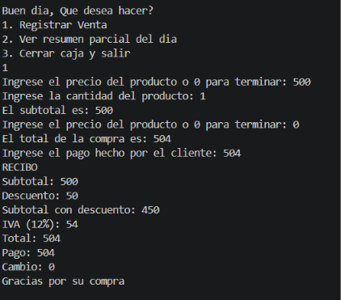